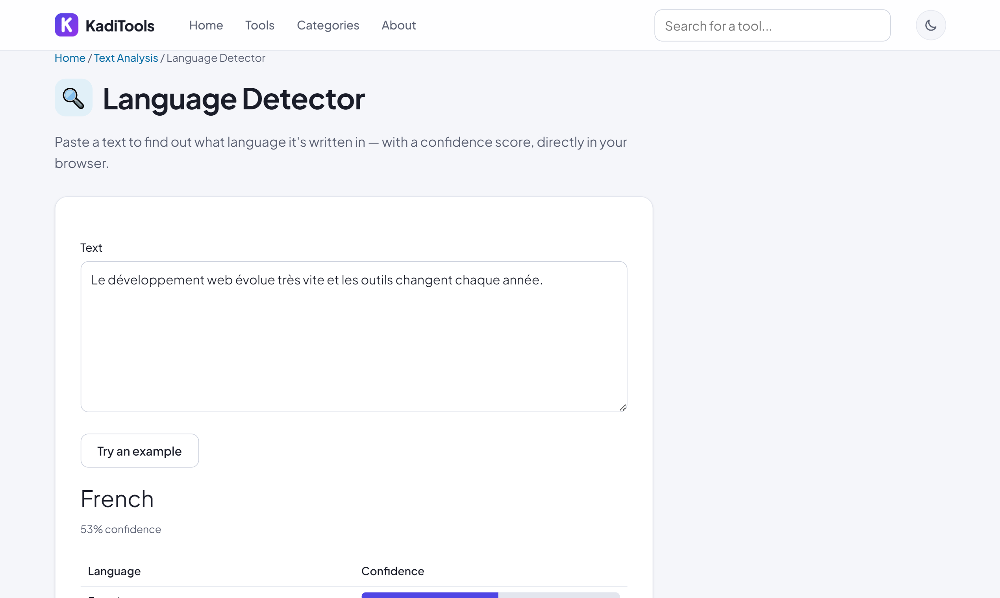
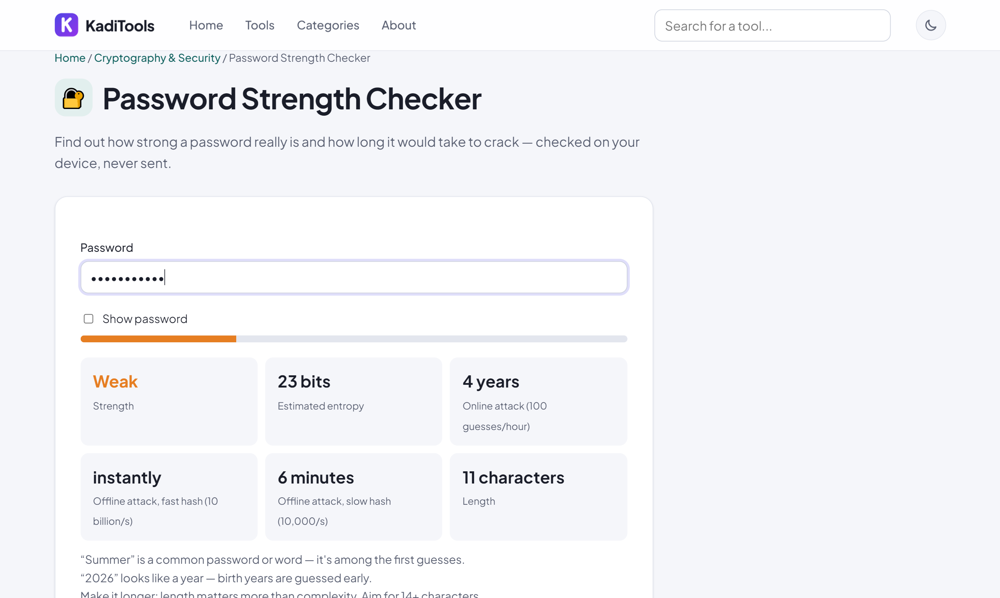
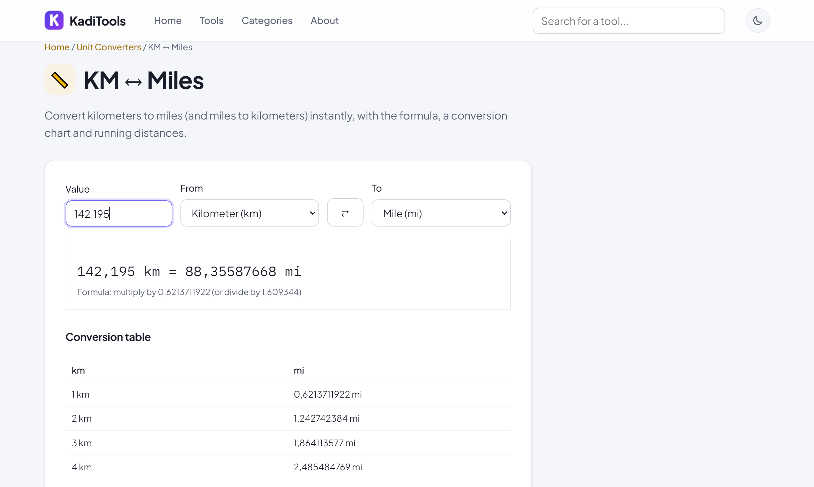

# KadiTools — 490+ free tools that run in your browser

**🔗 https://kaditools.com**

Free online tools for PDF, images, video, audio, text, developers, SEO, CV, business and more.
Everything runs **in your browser**: your files are never uploaded. No sign-up, no watermark, no limits.

## Popular tools

| Category | Tools |
|---|---|
| PDF & files | [Duplicate PDF pages](https://kaditools.com/tools/pdf/duplicate-pages/) · [Create ZIP](https://kaditools.com/tools/files/zip-creator/) · [Hex viewer](https://kaditools.com/tools/files/binary-file-viewer/) |
| Images | [Rotate image](https://kaditools.com/tools/image/rotator/) · [Add text to image](https://kaditools.com/tools/image/text-overlay/) · [Aspect ratio](https://kaditools.com/tools/image/aspect-ratio-calculator/) |
| Text | [Language Detector](https://kaditools.com/tools/smart/language-detector/) · [Title Case](https://kaditools.com/tools/text/title-case/) · [Lorem Ipsum](https://kaditools.com/tools/text/lorem-ipsum-generator/) |
| Developer | [JWT Decoder](https://kaditools.com/tools/cryptography/jwt-decoder/) · [Hex Converter](https://kaditools.com/tools/encoding/decimal-to-hex/) · [Unix Timestamp](https://kaditools.com/tools/time/unix-timestamp-to-date/) |
| Security | [Password Strength Checker](https://kaditools.com/tools/cryptography/password-strength-checker/) · [Secret Key Generator](https://kaditools.com/tools/cryptography/secret-key-generator/) |
| Calculators | [VAT Calculator](https://kaditools.com/tools/calculators/vat-calculator/) · [Date Difference](https://kaditools.com/tools/time/date-difference/) · [Average](https://kaditools.com/tools/calculators/average-calculator/) |
| Converters | [Celsius ↔ Fahrenheit](https://kaditools.com/tools/units/celsius-to-fahrenheit/) · [km ↔ miles](https://kaditools.com/tools/units/km-to-miles/) · [kg ↔ lbs](https://kaditools.com/tools/units/kg-to-lbs/) |
| Business | [Meeting Agenda](https://kaditools.com/tools/business/meeting-agenda-generator/) · [Quote Generator](https://kaditools.com/tools/business/quote-generator/) · [Receipt Generator](https://kaditools.com/tools/business/receipt-generator/) |

## Categories

PDF · Images · Video · Audio · Text · Text Analysis · Developer · Encoding · Cryptography & Security · SEO ·
CV & Jobs · Business · Finance · Student · Calculators · Unit Converters · Date & Time · QR Codes ·
Color & Design · Social Media · Files · Miscellaneous

## Screenshots

| | |
|---|---|
|  |  |
|  |  |

## Privacy

All processing happens locally with standard web technologies (Canvas, Web Audio, WebAssembly, Web Crypto).
Nothing you open in a tool is sent to a server, and there are no tracking cookies.

## Feedback

Found a bug or want a new tool? [Open an issue](../../issues) or write to contact@kaditools.com.
